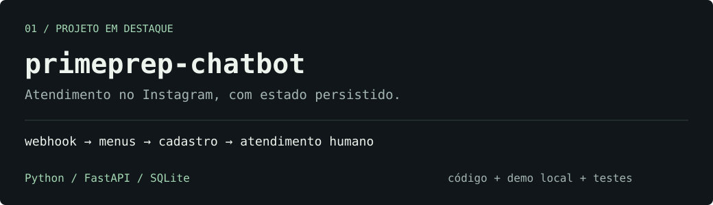
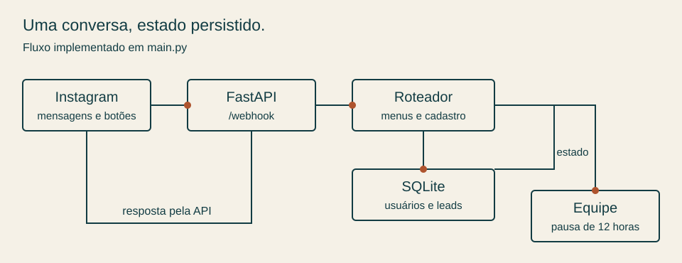

# Prime Prep · Chatbot para Instagram

Um atendimento por menus para responder dúvidas sobre um curso preparatório militar, registrar interessados e abrir espaço para a equipe continuar a conversa.

**Python · FastAPI · Instagram API · SQLite**

[Testar localmente](#teste-o-fluxo-sem-instagram) · [Arquitetura](docs/architecture.md) · [Configurar Instagram](docs/setup.md) · [English](docs/README.en.md)

## Por que construí

Na estruturação da Prime Prep, fiquei responsável pela parte administrativa, pelo site e pela presença digital. O chatbot foi desenvolvido para reunir as informações do curso em um atendimento acessível pelo Instagram e organizar o cadastro de quem demonstrasse interesse.

O projeto educacional está em pausa porque não encontramos um espaço físico para as aulas. Este repositório apresenta o código e uma demonstração local do fluxo; não há uma operação comercial ativa ou métricas de atendimento publicadas aqui.

## O que dá para examinar

| Parte do fluxo | Implementação |
| --- | --- |
| Primeira mensagem | Abre o menu principal, inclusive quando a mensagem inicial não é reconhecida. |
| Navegação | Quick replies e postbacks levam a concursos, curso, valores, matrícula e atendimento. |
| Cadastro de interesse | Coleta nome, idade, cidade e concurso; salva o lead após confirmação. |
| Continuidade | SQLite mantém estado, dados parciais e prazo de pausa por usuário. |
| Atendimento humano | Pausa o bot por 12 horas; comandos como `menu` podem reativá-lo antes. |
| Entrada por webhook | FastAPI recebe eventos e delega o processamento a `BackgroundTasks`. |

O roteamento usa regras e palavras-chave. O código não chama um modelo de linguagem. A opção chamada “Matrícula” registra um interessado, sem cobrança ou matrícula acadêmica concluída.

## Teste o fluxo sem Instagram

Requer Python 3.11 ou 3.12 e Git. A demonstração roda o roteador do próprio `main.py`, captura as respostas que seriam enviadas e cria um SQLite temporário.

```bash
git clone https://github.com/4Kwko/primeprep-chatbot.git
cd primeprep-chatbot
python -m venv .venv
```

Ative o ambiente:

```powershell
# Windows PowerShell
.venv\Scripts\Activate.ps1
```

```bash
# macOS / Linux
source .venv/bin/activate
```

Instale as dependências e execute o exemplo completo:

```bash
python -m pip install -r requirements.txt
python demo.py --scripted
```

Para conversar pelo terminal, digite `python demo.py`. Selecione o número de uma opção ou escreva uma mensagem. Use `/sair` para encerrar.

A demonstração bloqueia as requisições HTTP do bot, não lê `.env` e remove o banco temporário ao terminar. Não precisa de token e não envia mensagens reais.

<details>
<summary>Exemplo do caminho de cadastro</summary>

Os dados abaixo são fictícios. O texto completo é produzido pelo código ao executar a demonstração.

```text
oi
  → Menu principal
Matrícula
  → Nome: Pessoa Exemplo
  → Idade: 18
  → Cidade: São Gabriel
  → Concurso: ESA
Confirmar
  → Lead salvo no SQLite
Atendimento
  → Bot pausado para a equipe
menu
  → Retorno ao atendimento automático
```

O [roteiro e o simulador](demo.py) executam esse caminho. Os [testes](tests/test_demo.py) conferem confirmação, idade inválida, cancelamento, pausa, isolamento e assinatura com segredo configurado.

</details>

## Como as partes se conectam



O [guia de arquitetura](docs/architecture.md) detalha os estados e aponta as funções no código. O [guia de configuração](docs/setup.md) separa a execução local da conexão com o Instagram.

## Estrutura do repositório

```text
main.py                 Webhooks, menus, estados, banco e envio
subscribe.py            Consulta a conta vinculada ao token
demo.py                 Demonstração offline do roteador
.env.example            Nomes das variáveis de configuração
tests/test_demo.py      Verificações locais da conversa
docs/                   Arquitetura, configuração e versão em inglês
.github/workflows/      Execução das verificações no GitHub Actions
```

Apesar do nome, `subscribe.py` apenas consulta `user_id` e `username`; não faz a assinatura de eventos do aplicativo.

## Verificações

```bash
python -m unittest discover -s tests -v
```

Os testes usam dados fictícios e chamadas HTTP interceptadas. Não validam permissões, entrega de mensagens ou a configuração de uma conta real da Meta. O workflow executa as mesmas verificações em Python 3.11 e 3.12.

## Limites desta versão

- O endpoint `GET /leads` não tem autenticação e retorna dados de cadastro. Não exponha essa rota publicamente com dados reais.
- A validação HMAC existe, mas o código aceita eventos quando `APP_SECRET` está vazio. Configure o segredo e revise esse comportamento antes de uma implantação.
- O código registra mensagens e dados de leads nos logs. Uso real exige revisar esse registro, o acesso ao banco e o tratamento dos dados coletados.
- A passagem para atendimento humano é uma pausa e um link de contato. Não existe integração de alerta para a equipe neste código.
- Os conteúdos sobre concursos refletem referências de 2026. Revise informações, links e horários antes de reutilizar o projeto.

## Autor

[João Montagner](https://github.com/4Kwko) · [LinkedIn](https://www.linkedin.com/in/jo%C3%A3o-montagner-704aa92b5/)

Desenvolvimento de sistemas, automações e integrações. A lógica original do chatbot permanece em `main.py`; a demonstração facilita sua avaliação local.
