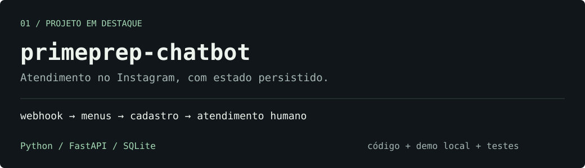
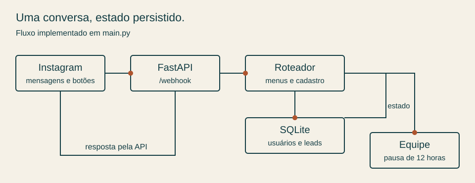

# Prime Prep · Instagram chatbot

A menu-based chatbot for a military entrance exam preparation course. It answers common questions, records prospective students and pauses automated replies when someone asks for the team.

**Python · FastAPI · Instagram API · SQLite**

[Português](../README.md) · [Architecture](architecture.md) · [Instagram setup](setup.md)

## Context

I developed this chatbot while setting up Prime Prep, where I also handled administration, the website and digital presence. The education venture is currently on hold because suitable classroom space could not be secured. This repository provides the code and a local demonstration; it does not claim an active commercial deployment or published usage metrics.

## Try the conversation locally

Use Python 3.11 or 3.12:

```bash
git clone https://github.com/4Kwko/primeprep-chatbot.git
cd primeprep-chatbot
python -m venv .venv
```

Activate with `.venv\Scripts\Activate.ps1` on Windows PowerShell or `source .venv/bin/activate` on macOS/Linux. Then:

```bash
python -m pip install -r requirements.txt
python demo.py --scripted
```

For an interactive terminal session, run `python demo.py`. Select an option number or type a message; `/sair` exits.

The demo executes the existing conversation router in `main.py`. It intercepts HTTP calls, disables `.env` loading and uses a temporary database that is removed afterwards. No Instagram account or access token is needed. All example registration data is fictional.

## What the implementation contains

- Quick replies and postbacks for course details, exams, prices, registration and team support.
- A registration flow that collects name, age, city and target exam, then persists the lead after confirmation.
- SQLite conversation state, partial registration data and pause deadlines.
- A 12-hour pause for human support, with commands such as `menu` to resume earlier.
- Webhook verification, HMAC checking when a secret is configured, and background event processing.

The router uses rules and keywords, with no language-model calls. “Matrícula” is the menu label for registering interest; it does not complete enrollment or collect payment. Attachments receive navigation guidance rather than audio transcription or image analysis.



## Checks

```bash
python -m unittest discover -s tests -v
```

The tests cover confirmed registration, invalid age, cancellation, support pause and resume, demo isolation and HMAC with a configured secret. GitHub Actions runs the checks on Python 3.11 and 3.12. These checks do not verify a real Meta app, permissions or message delivery.

## Current boundaries

`GET /leads` has no authentication. An empty `APP_SECRET` currently bypasses HMAC validation, and logs include conversation and lead data. These behaviors need review before exposing the service with real personal data. The current send path logs failures without retries, and background tasks are not a durable queue.

The human-support path creates a pause and provides a contact link; it does not notify a separate team system. Course and exam content is based on 2026 references and needs review before reuse.

`subscribe.py` only queries the account associated with the token. Despite its name, it does not subscribe the app to webhook events. The detailed [architecture](architecture.md) and [setup guide](setup.md) are available in Portuguese.

## Author

[João Montagner](https://github.com/4Kwko) · [LinkedIn](https://www.linkedin.com/in/jo%C3%A3o-montagner-704aa92b5/)
