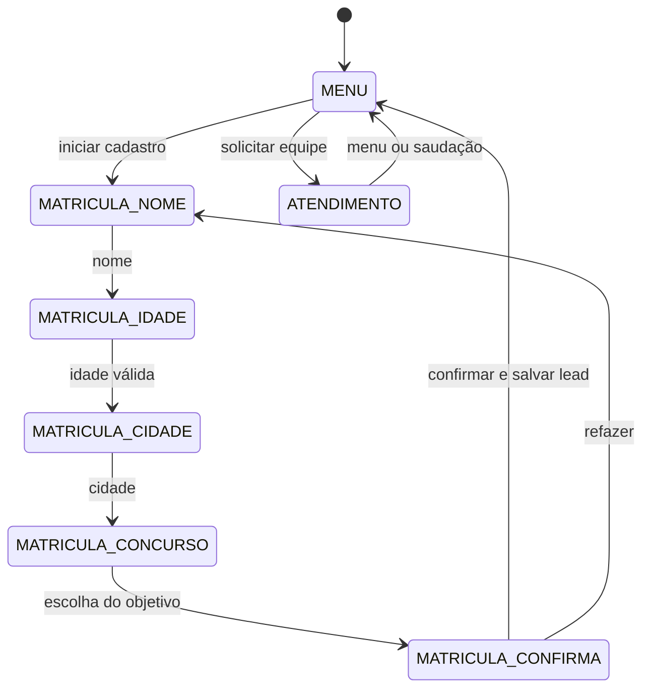

# Arquitetura e leitura do código

[Voltar ao README](../README.md)

## Entrada e saída

`GET /webhook` responde ao desafio de verificação quando `hub.mode=subscribe` e o token corresponde a `VERIFY_TOKEN`. `POST /webhook` lê o corpo, verifica `X-Hub-Signature-256` e agenda cada evento em `BackgroundTasks`.

`processar_evento` identifica o remetente, ignora mensagens com `is_echo` e diferencia quick replies, texto, anexos e postbacks. Anexos recebem uma orientação de navegação; o bot não transcreve áudio nem interpreta imagens.

`enviar_mensagem` e `enviar_opcoes` constroem o payload. `_postar` usa `requests` para enviá-lo ao endpoint definido em `API_URL`, atualmente com versão `v26.0` no código.

## Estados persistidos

O diagrama mostra o caminho principal. Os comandos globais de menu e cancelamento e os botões de navegação também alteram o fluxo. Quando a pausa expira, o bloqueio de respostas deixa de valer; o próximo evento segue o roteador, sem uma tarefa de retomada agendada.

## Modelo de dados

| Tabela | Campos e finalidade |
| --- | --- |
| `usuarios` | `usuario_id`, `estado`, `dados` em JSON, `pausado_ate` e `atualizado`. Mantém a conversa entre eventos. |
| `leads` | ID interno, usuário, nome, idade, cidade, concurso e data de criação. Recebe o cadastro confirmado. |

O banco é criado ao importar `main.py`. O caminho vem de `BANCO_PATH`, com `primeprep.db` como padrão. As consultas usam parâmetros para valores de usuários. `/leads` mostra no máximo os 200 registros mais recentes; seu campo `total` é o tamanho desse resultado, não a contagem histórica de toda a tabela.

## Caminho sugerido para avaliar

1. Execute `python demo.py --scripted` para acompanhar uma conversa completa.
2. Leia `processar_evento`, `tratar_texto` e `tratar_opcao` em [main.py](../main.py).
3. Siga `iniciar_matricula` até `finalizar_matricula` para ver a persistência.
4. Confira `acionar_atendimento`, `esta_pausado` e `pode_reativar_bot`.
5. Execute os [testes](../tests/test_demo.py) e examine os limites descritos no README.

## Decisões e pontos de evolução

SQLite concentra estado e cadastros em um arquivo e permite testar sem configurar um servidor de banco. A organização em um único módulo facilita seguir o fluxo inicial; separar conteúdo, persistência e integração seria uma evolução quando o projeto retomasse operação.

O processamento em segundo plano utiliza o processo da aplicação, sem fila durável. O envio registra falhas, mas não implementa retentativas nem deduplicação de eventos. São pontos a tratar antes de exigir entrega confiável ou aumentar a carga. Não há resultado de teste de carga publicado.
